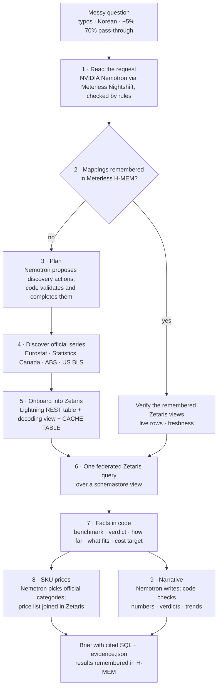

# PriceSignal

[](https://github.com/rose050505/pricesignal/actions/workflows/ci.yml)

**An agent that compares an exporter's proposed price changes with official inflation and a separate cost recovery target, with the data and SQL behind each result.**

Open Agent Hackathon 2026 · Track 01 — Solving Fragmented Intelligence · built with **Zetaris**, **Meterless** (Nightshift runtime + H-MEM engine) and **NVIDIA Nemotron** (via Nightshift).

**Video:** (link added after upload) · **Recorded runs with full traces:** [examples/](examples/) · [Sample inputs and outputs](#sample-inputs-and-outputs) · [How each sponsor is used](#sponsor-technology)

*Wording in the demo video: its "suggested price range" is the market benchmark (from the latest year-on-year rate to the 12-month mean) and its "new price for every product" is each SKU's benchmark price scenario. Both are historical comparisons, not recommended prices.*

| Sponsor | What it does here | Where you see it |
|---|---|---|
| **Zetaris** | Registers each agency API at run time as a Lightning REST table with a decoding schemastore view, caches it (`CACHE TABLE`), answers each comparison with one federated query over a business view, and joins the company price list | Trace `onboard` and `sql` lines; the federated-query card |
| **NVIDIA Nemotron** (Nightshift's NVIDIA API lane) | Reads the messy request, proposes the discovery batch, picks official categories for products, writes the explanation; code checks every number, verdict and trend claim | Header model badge; "NVIDIA Nemotron in this run"; SKU table reasons |
| **Meterless Nightshift** | The AI runtime behind every model call (provider contract, hedged calls, thinking switch) | "via Meterless Nightshift" in the trace |
| **Meterless H-MEM** | Remembers policies, requests, verified mappings and last results, so a follow-up can skip planning and discovery | "Remembered with Meterless H-MEM" card; [02_same_as_last_time](examples/02_same_as_last_time/brief.md) |

**See it without Zetaris, Nightshift or keys:** open the [replay of the recorded runs](https://rose050505.github.io/pricesignal/) (the real UI, fed by eight recorded traces and results; no live calls), or run it locally:

```bash
npm install
npm run demo                                              # http://localhost:5179: the same replay
npm run verify -- examples/01_cold_start/evidence.json    # re-derives the benchmarks, verdicts and SKU prices from the saved SQL rows
```


*Live UI, 27 Oct 2026 19:00 KST (demo question 1, cached Zetaris sources, fresh memory, complete in 38 s). Nemotron's first headline said food inflation was easing in all three markets; the fact check rejected it because Australia is flat (see the live trace), and its headline-only rewrite is the one shown.*

---

## The problem

A small food exporter selling into Germany, Canada and Australia wants to check a proposed +5% price rise against market history and its own costs. The answer sits in three official statistics agencies that do not agree on anything:

| | Germany | Canada | Australia |
|---|---|---|---|
| Agency | Eurostat (HICP) | Statistics Canada (CPI) | Australian Bureau of Statistics (CPI) |
| Format | JSON-stat 2.0 | WDS JSON | SDMX-JSON 2.0 |
| What it publishes | annual rate of change | index, 2002 = 100 | index, monthly and quarterly series |
| Category scheme | ECOICOP v2 (`coicop18`) | product/vector ids | ABS index codes |
| Gotcha we hit | the dataset everyone links to (`prc_hicp_manr`) stopped at 2025-12 and was replaced by `prc_hicp_minr` | the data methods used in public recipes are POST-only; the GET method returns a top-level array | a broad query is too large for one fetch; series must be scoped to one key |

Assembling the evidence by hand means reconciling three APIs, three formats, different category schemes and different release calendars. Our latest recorded cold run used a fresh memory store and new Zetaris application tables/views: 25 s including CLI startup, with market numbers at 14.0 s. PriceSignal keeps the receipts; a repeat question reuses remembered mappings after checking their live rows and freshness. When every requested mapping is remembered, it also skips the planning model call; stale or unavailable views go back through discovery.

## Who it is for

A pricing or sales manager at a small exporter who has to justify a price change in several countries at once: the annual price review, or a price-increase request to a foreign distributor or retailer that asks "what is inflation doing in our market?". Today that means opening each agency's site, finding the right category table, converting an index to a year-on-year rate and noticing when a dataset moves (Eurostat's widely linked `prc_hicp_manr` stopped in December 2025). PriceSignal does that work for every market in one question and keeps the receipts: the series ids, the SQL and an evidence packet anyone can re-check. It covers 17 markets today (14 EU members through Eurostat, Canada, Australia and the United States), reads a company's own price list from any endpoint Zetaris can reach (`PSIG_PRICE_LIST_URL`), and keeps the data in the company's Zetaris. We have not measured time savings with real users; the work per question is visible in each trace (see [Recorded runs](#recorded-runs)).

## What is different here

- **Sources are onboarded when the question needs them.** There is no fixed pipeline: the agent finds each official series, registers it in Zetaris as a REST table with a decoding view, caches it, and queries all markets in one federated statement. When an agency moves a dataset (Eurostat's `prc_hicp_manr` → `prc_hicp_minr`) or skips a month (BLS has no October 2025 CPI), the brief says so.
- **The model never supplies a number.** Rates, benchmarks, verdicts and prices are computed in code from the SQL rows; Nemotron reads the request, plans, picks product categories and explains, and every sentence it writes is checked against the computed facts before it is shown.
- **Every answer can be re-checked later.** Each run saves an evidence packet with the SQL, the rows and the results; `npm run verify` re-derives them offline, and the replay site shows the recorded runs in the real UI.
- **Memory changes the next answer.** H-MEM recalls verified mappings, the pricing policy and the last result, so a follow-up skips planning and market discovery and reports what changed since the last brief.

## What it does

1. **Reads a messy request**: typos, nicknames (`deutschland`, `aus`), Korean or English (the brief itself is written in English), a proposed change, a cost change with its share of the selling price, and a pass-through policy.
2. **Finds the official series** at Eurostat, Statistics Canada, the ABS and the US Bureau of Labor Statistics, and says what it had to work around (a discontinued dataset, a coarser category, another frequency).
3. **Onboards each series into Zetaris** as a Lightning REST table, a decoding view and a `CACHE TABLE` copy, then compares the markets with **one federated query** over a schemastore view.
4. **Joins the company's price list** in Zetaris; for snack and condiment products Nemotron picks the official category from a shortlist, and code validates the pick.
5. **Computes the facts in code**: latest year-on-year rate, one-year mean, the historical benchmark between them, how far the proposal sits from it, which change fits every market, and a separate cost-recovery target.
6. **Explains with Nemotron, checked sentence by sentence**: numbers, verdicts and trend claims must match the computed facts; a wrong headline is rewritten, wrong sentences are removed and listed.
7. **Remembers with Meterless H-MEM**: policies, verified mappings and each market's last result, so "same as last time, but +3%?" skips planning and market-series discovery and says what changed.
8. **Lets you try another proposal** in the browser, and **keeps an evidence packet** that `npm run verify` re-checks offline.

<details>
<summary><b>Each step in detail</b>: inputs, fallbacks, edge cases, and what the benchmark, the same-period table and the cost target mean</summary>

1. **Understands a messy request** — typos, country nicknames (`deutschland`, `aus`), Korean or English, a proposed change (`+5%`, `-.5%` or `+0,5%`; a range such as `3-4%` is reported and needs one value; a number in words such as `four percent` is used only when Nemotron read the same number), a cost recovery policy (`we pass on ~70% of cost increases`), a stated cost change and an optional cost share with its timing (`before the cost change, unit costs were 60% of the selling price`). An explicit comparison such as “food inflation” takes priority over product names in the introduction. The UI shows the interpreted market category; “same as last time” keeps only assumptions the user did not change. Explicit changes such as “pass-through from 70% to 50%” update that field without turning the new policy into a price proposal. One market category is compared per brief.
2. **Looks up official series** — by catalogue lookup at Eurostat and ABS, from a vetted vector list at Statistics Canada — and reports what it had to work around (a discontinued dataset, a coarser category, a different frequency).
3. **Onboards each series into Zetaris** as a Lightning REST table plus a decoding view with a common schema, then caches the raw REST table in Zetaris (`CACHE TABLE`). Later queries read the cached response instead of calling the agency again, so a series that was cached before its agency went down stays available while Zetaris keeps running. A series that could not be cached, and discovery of a new series, still depend on the agency answering.
4. **Answers with one federated SQL query** across the agencies in Zetaris. The query reads a business-facing Zetaris schemastore view (`psig.v_market_inflation_<hash>`, created with `CREATE OR REPLACE SCHEMASTORE VIEW` over the agency views in the common schema). If that view cannot be created, the same comparison runs as a direct `UNION ALL` over the agency views. A separate same-period table finds the latest month or quarter actually observed in every requested market, using those same query rows. This makes different release dates visible while preserving each market's latest benchmark.
5. **Joins the company's own price list.** The exporter's internal price list (SKU, market, product category, current shelf price) is a Zetaris REST table too. For SKUs in the snacks and condiments categories, Nemotron sees the actual product names alongside the official candidates and chooses one (for example, honey butter chips rather than the word snacks alone); other SKU categories use catalogue word matching and are omitted when nothing matches. Code validates that choice before onboarding. A second federated query joins each SKU to the chosen category or an explicitly marked broader Food proxy, then code calculates hypothetical prices at those benchmark rates.
6. **Computes the facts in code** — latest year-on-year inflation, a recent one-year mean with the actual observation count, trend where a six-month comparison exists, the historical benchmark and the proposal's position against it. The model explains these facts. Numeric, comparison and "every market" trend checks run on each sentence (a draft saying food inflation is "easing in all three markets" is rejected when code computed one market as flat, and one saying "food inflation is above the benchmark" is rejected because the verdict belongs to the proposal). The model is given one line with the verdicts and trends per market (`headline_facts`) and writes its headline after the market paragraphs. A mismatch triggers one rewrite, and when only the headline is wrong, Nemotron is asked for a new headline alone so the checked paragraphs stay as they are; if that also fails, the contradicting sentences are removed and listed in the brief and the UI (the headline is then computed in code), and a computed summary is used only when nothing usable is left. A "How far" line under the headline gives the distance, in percentage points, from each market benchmark and from the cost-recovery scenario. The next line says which change would sit inside every market benchmark: the common range, or, when the benchmarks do not overlap, the two markets that disagree and each market's top (benchmark ends restated, not a recommended price). When a comparison mixes food indices that include restaurant and take-away meals (StatCan Food, ABS Food and non-alcoholic beverages) with one that does not (Eurostat COICOP 01), a basket note says so.
7. **Separates cost recovery from the market.** With an 8% cost rise, a **before-change** unit cost of 60% of the unchanged selling price and 70% recovery, the target is `8% × 60% × 70% = 3.36%` (displayed as 3.4%). If that 60% share instead describes costs **after** the 8% rise, the target is `60% × 8% / 1.08 × 70% = 3.11%` (displayed as 3.1%). The brief shows the cost timing; when unspecified, it explicitly assumes before-change costs. Missing or unusable inputs produce no cost target. The historical market benchmark is independent of this policy.
8. **Remembers** (Meterless H-MEM): series mappings, the user's pricing policy and the last request persist across sessions. "Same as last time, but +3%?" is resolved from memory, and remembered mappings skip discovery and onboarding while they still pass live freshness checks. Mappings marked for review must be rediscovered and verified before reuse. Remembered request scope includes unsupported countries; repeating a Japan-only request does not silently switch to default markets. If all requested market mappings are remembered, no planning model turn is needed. Each market's result is remembered too, so the next brief opens with "Since your last brief": whether a new official release arrived, whether the benchmark moved and how the verdict changed (example 04). Product-checked SKU selections have separate memory scopes keyed by their product set; changing products, stale data, a review flag or a selection-version change triggers a new choice. The UI reports agent model calls (including hedged calls), planning calls, discovery calls and reused views. Internal provider retries can add HTTP attempts beyond this model-call count.

9. **Previews another proposal locally.** After a brief finishes, change the percentage in “Try another price change” to compare it with the same market benchmarks and recalculate available SKU prices from their original current prices. This separate preview sends no request, refreshes no data and writes no memory. The original narrative, proposal, cost target and saved request stay unchanged. The panel shows the run time and each observation period; unsupported or missing market evidence stays unavailable.

10. **Keeps a replayable calculation record.** The CLI writes a versioned `evidence.json` beside the brief: interpreted inputs, calculation time, actual market and pricing query columns/rows, and derived results. `npm run verify -- path/to/evidence.json` checks those calculations offline, without credentials, a memory store or live services. It reports missing coverage explicitly.

The result header distinguishes complete, partial and missing coverage of the requested market category. If that category is unavailable, an all-items series is shown as context only: it supplies no category benchmark, proposal verdict or cost-to-market comparison. A valid cost recovery target remains available independently. Explicit all-items requests and visibly labelled broader Food proxies mapped to the requested category retain their own comparisons. Unsupported countries count toward the requested total. A recovered SKU series does not imply that the market comparison also recovered. The model badge names successful model responses from the current run; provider-error text is not a model identity.

**What the market benchmark means.** It spans the latest official year-on-year rate and the mean of valid observations in the 12-month window ending at the latest observation: up to 12 monthly or four quarterly readings. The UI shows the actual coverage. Equal values produce a single reference point; negative rates remain negative. This is a descriptive comparison, not a confidence interval, a forecast, or an estimate of customers' willingness to pay. The SKU price scenario applies that same historical percentage to the current sample price; it is not a recommended price.

**What the same-period table means.** It aligns the observation date of the selected official series, with category labels, source IDs and the query reference. National baskets and category coverage can still differ. It refuses mixed monthly/quarterly sources, missing requested categories, conflicting duplicate observations or an empty period intersection instead of filling gaps. Old common periods show their age. It does not replace latest-release benchmarks, price scenarios or remembered outcomes, and needs no additional source or model call.


*Rendered from a live follow-up on the afternoon of 27 Oct ("same as last time, but Germany and Australia at +3%?"; an earlier run, not one of the recordings in examples/): both markets have August 2026 observations (DE 0.2%, AU 2.98%, displayed as 3.0%), while Germany's latest September reading remains 0.4% in its market card. That run reused eight views and made no planning or discovery calls; it took 64 s, before the thinking-switch fix. The current examples show the same table (for example [02_same_as_last_time](examples/02_same_as_last_time/brief.md)).*

**What the cost target means.** Both timing options use the same selling price, before applying the proposed change. A before-change cost share multiplies the stated cost change and recovery policy directly; an after-change cost share first divides by `1 + cost change / 100` to recover the baseline. Cost share and timing are remembered together. A new share without timing uses the stated before-change assumption. The calculation requires consistent units, currency and selling-price basis, and holds sales volume and cost mix fixed. A 100% cost reduction cannot be inverted from an after-change share; a target that would imply a negative selling price is omitted, not clamped. The supported cost-share input is 0–100% of selling price. This does not estimate a target profit margin, taxes, exchange-rate changes or demand response.

The sample price list in `data/price_list.json` is illustrative data for a fictional K-food exporter. To use your own prices, set `PSIG_PRICE_LIST_URL` to an endpoint reachable from Zetaris with the same JSON schema, then start a new app process with a **fresh `PSIG_ZETARIS_NS` and memory directory**. Existing Zetaris REST tables keep their originally registered endpoint: changing the URL alone does not update them.

</details>

## Architecture



Guardrails in code: the SQL allowlist (one `SELECT`, onboarding DDL or `CACHE TABLE` statement at a time), validation of every planned action and model-picked category, live freshness checks before a remembered view is reused, and the per-sentence fact check. Rates, benchmarks, verdicts and prices are computed in code, never by the model.

## Sponsor technology

**Zetaris** is where the fragmented sources become one dataset.

- **Registration at run time.** The agent registers each agency endpoint with `CREATE LIGHTNING REST TABLE` and a decoding `CREATE SCHEMASTORE VIEW` (JSON-stat, WDS and SDMX are flattened in Lightning SQL), all in a common schema `(country, concept, category_label, frequency, period, yoy_pct, source_id)`. Onboarding is idempotent: when Zetaris already has a table or view from an earlier run, the trace says so ("already in Zetaris") instead of claiming it was created.
- **One federated query per comparison.** Market rates come from one query over a `CREATE OR REPLACE SCHEMASTORE VIEW` that unions those views (a direct `UNION ALL` when that view cannot be created), and the brief cites the statement id (Q7, Q8, …) next to each rate, with the SQL behind it listed at the end.
- **The company's own data.** The internal price list is registered the same way (`PSIG_INTERNAL`), and a second federated query joins each SKU with its selected official category or a marked broader Food proxy; the per-SKU rate, average and benchmark are then computed in code like the market facts.
- **Validation.** Remembered and newly onboarded views must return a valid observation count and a non-future monthly/quarterly period within the freshness window (three months for monthly series, six for quarterly). ABS and StatCan index views calculate YoY only against the same month or quarter one year earlier with a positive denominator. Versioned decoding views keep monthly and quarterly definitions separate; obsolete mappings are rediscovered and replaced only after the new view passes validation. Source IDs stay unchanged, and the brief distinguishes a decoder change from an official data revision. A small successor map handles known dataset moves, such as Eurostat's `prc_hicp_manr` → `prc_hicp_minr`.
- **SQL allowlist.** Every statement the agent sends passes an allowlist (`SELECT`; the `CREATE LIGHTNING …` / `CREATE [OR REPLACE] SCHEMASTORE …` statements used for onboarding and the business view; `CACHE` / `UNCACHE TABLE`, which the agent issues only for raw source tables), one statement at a time; anything else is blocked in code.
- **Caching.** The agent caches each raw table with `CACHE TABLE` after registering it and before reusing a remembered view. `scripts/17_cache_check.mts` measures what that does ([output, 27 Oct 2026](docs/measurements/zetaris-cache-2026-10-27.txt)): a test REST table called its source on every uncached `SELECT` and on `CACHE TABLE`, then no more until `UNCACHE` (`REFRESH TABLE` does not reload; `UNCACHE` then `CACHE` does, and `CACHE TABLE` on a cached table costs nothing). Over the DE/CA/AU tables of two example recordings (including the current one), the federated comparison took 5.7–8.8 s uncached and 1.4–1.8 s cached, and the price-list join 2.8–3.4 s and 0.9–1.2 s; uncached timings depend on agency latency. After `PSIG_CACHE_TTL_HOURS` (default 6) the agent refreshes with `UNCACHE` + `CACHE` only when the agency answers, so an outage never drops the cached copy. The cache lives in the running Zetaris server and is lost when Zetaris restarts; durable snapshots are not implemented.

**Meterless Nightshift** is the application's primary AI provider.

- **Provider contract.** OpenAI-compatible `/v1/chat/completions`, Bearer runtime token, `meterless-app` on every request, `meterless-scope: user` on chat, `GET /v1/models` to decide online / unauthorized / offline, and the `meterless/fast` routing mode (`meterless/deep` is configurable but not used by default). The model that served each step is shown in the agent trace (`tests/llm-contract.test.ts`).
- **Hedged calls.** Nemotron's response time through Nightshift varied from about 1 s to over 50 s between consecutive calls on 26 Oct (that day's recorded traces are in Git history), so parsing, planning and narrative calls are hedged: if no reply has come after 10 s (`PSIG_HEDGE_MS`), the same request is sent once more, the first reply wins and the other request is cancelled; the trace says when this happened.
- **Thinking switch.** Every call sends Nemotron's chat-template switch `enable_thinking: false`: the `/no_think` prompt flag and reasoning-effort hints alone did not stop the hidden reasoning through Nightshift. Measured with `scripts/18_nemotron_check.mts` ([output](docs/measurements/nemotron-nightshift-2026-10-28.txt)): reading demo question 1 took 3.4–5.0 s and 91 output tokens with the switch, and 56–63 s and 2,300–2,700 tokens without it. Before the switch, the SKU choice and the narrative regularly ran out of their 20 s and 55 s budgets; with it, demo question 1 completed in 15–38 s across our runs (the screenshot above is the 38 s UI run; the eight recorded runs below took 9–34 s each). A runtime that rejects the field gets the request again without it, and the hedged second request is always sent without it, so another lane can answer (`tests/agent.test.ts`).
- **Time budgets.** Request reading gives up within about 25 s (15 s per request, one hedge) and falls back to rules, the planner gets 25 s of total reply time (`PSIG_PLAN_BUDGET_MS`; then the remaining series are completed in code), the SKU category choice 20 s (then a marked Food proxy) and the narrative 55 s (`PSIG_NARRATIVE_BUDGET_MS`; then a computed summary), so a slow provider cannot stop a brief.

**Meterless H-MEM** gives the agent memory across sessions. We run the Meterless reference engine unchanged (`src/hmem_impl.ts` re-exports it, and `npm run conformance` runs the official suite against that file: 13/13). Our work is in how the agent uses it:

- **Mappings change what the agent does.** Series mappings are long-term factual memories with structured tags; a recalled mapping skips discovery and onboarding (after a live freshness check), and when every mapping is remembered the planner is not called at all.
- **Superseded, not deleted.** A re-onboarded series or a changed pricing policy supersedes the old record (`supersededBy`), so H-MEM's own retrieval ranks it down too; the brief says when a policy was remembered rather than stated.
- **What changed since last time.** The last request and each market's last result are stored, so "same as last time, but +3%?" works and the brief opens with "Since your last brief" (new release or not, benchmark moved or not, verdict change).
- **Exact reads where exactness matters.** Mappings, the latest policy and the last request are read by exact tags rather than H-MEM's ranked search, because the agent must reuse exactly the series it verified (a near match would be a different statistic); the planner's `recall_memory` action uses the ranked query. Reused mappings get `helpful` feedback, recorded in H-MEM; it does not yet change which mapping is reused.

**NVIDIA Nemotron** does the agent's language work: it reads the messy request (typo markets, unfamiliar categories), proposes the discovery batch, picks SKU categories from an official shortlist and writes the checked explanation.

| What Nemotron did in the eight recorded runs | Replies | Outcome |
|---|---|---|
| Read the messy request | 8 | 8 of 8 read by Nemotron, Korean included; code extracts every percentage and checks the markets |
| Plan discovery and onboarding | 7 | Only in the 4 runs that needed new series; the 4 runs with remembered mappings needed none |
| Pick official categories for products | 2 | 4 of 5 product groups accepted; code rejected 1 (a chips/crisps conflict) and used a marked Food proxy |
| Write the brief | 9 drafts | 8 of 8 headlines passed the fact check, 1 after a headline-only rewrite |

25 of the 26 replies came from Nightshift's NVIDIA API lane (`nvidia/nemotron-3.5-lightning-30b-a3b`) and one from its OpenRouter lane (`openrouter/nvidia/nemotron-3.5-lightning`, the same model).

- **The setting that mattered most** was Nemotron's chat-template switch `enable_thinking: false` (request reading 3.4–5.0 s instead of 56–63 s; see Meterless Nightshift above). `max_tokens` is set close to each answer's size; in the same measurement it made no difference to speed (a narrative draft took 2.7–3.1 s at both 1,024 and 8,000).
- **Lanes.** Nightshift serves the app's `meterless/fast` calls from its "Use tools & agents" lanes, both NVIDIA Nemotron 3.5 Lightning: one forwards to NVIDIA's API, one to OpenRouter. With the thinking switch on, Nightshift mostly routes the calls to the NVIDIA API lane; a hedged second request goes without the switch, so the OpenRouter lane can still answer if the NVIDIA lane stalls. Earlier traces (in Git history) show `openrouter/nvidia/nemotron-3.5-lightning`.
- **Product categories.** For narrow SKU categories, one bounded request sees product names and official candidate labels and selects an index with a coverage reason; it cannot invent a source or query. Code rejects invalid choices, known savoury-chip/confectionery conflicts and reasons containing numeric claims or common price-advice patterns. The choice has a 20-second limit and no hedge; failure uses a verified broad Food series, visibly labelled, or omits those SKU prices when no such alternative is usable. Validated model selections are remembered separately from general market mappings.
- **Numbers stay in code.** Figures and verdicts are computed from the Zetaris rows, so neither a planner reply nor a model outage can change them (`tests/planner-cannot-move-numbers.test.ts`); every prompt is in `src/prompts.ts`.

## Markets

Germany, Canada and Australia are the demo markets. Because Eurostat publishes HICP for every EU member through the same API, the same discover-and-onboard path also covers France, Italy, Spain, the Netherlands, Belgium, Austria, Ireland, Portugal, Finland, Sweden, Denmark, Poland and Czechia (market names, local names or ISO codes). The United States is read from the U.S. Bureau of Labor Statistics CPI (CPI-U, U.S. city average, Food and All items), a fourth API with its own format: index levels as year and "M01"–"M12" pairs nested in JSON, decoded and turned into same-month YoY in Lightning SQL like the Canadian and Australian indices. Markets outside these (for example the UK, Japan, China or Korea) are reported as not covered rather than silently dropped. The EU path was verified live on 27 Oct 2026 for France, Italy and Spain (six views registered, one federated query of 90 rows; see `examples/06_eu_markets`). The sample price list only has SKUs for Germany, Canada and Australia.

## Limits (stated, not hidden)

- **Canada and the US:** the adapters map only the Food and All-items series (StatCan vectors; BLS CPI-U), so narrower categories (snacks, sauces) are compared at the Food level and the brief says so.
- **US source limits:** the BLS API is used without a key, which allows 25 requests a day per address and returns the last three years. Discovery therefore uses a vetted series list instead of calling the API, and each series is cached in Zetaris right after registration; a new Zetaris suffix registers (and calls) the series again. The sample price list has no US SKUs.
- **SKU categories:** snacks and condiments use product-aware model selection from a bounded official shortlist; other categories are matched by catalogue words. A broader series can still be the best available proxy; the table distinguishes model-selected, remembered and unconfirmed matches and names the actual series. This is a coverage check, not a guarantee that an official category precisely describes each product. Market-category lookup is a separate catalogue-matching path. A guard rejects known sweet-only categories for a snacks comparison and uses a verified broader Food alternative or omits the category. This targeted guard does not validate every possible product match. The current recordings include this guard and the explicit comparison-category override; check each actual series label.
- **Historical benchmarks are descriptive.** A point or narrow span is possible; it does not express confidence, price headroom or a prediction. A proposal 0.2 pp or less outside a benchmark is named as a close call in the "How far" line rather than treated as a hard threshold. Cost recovery requires a stated cost change and a cost-to-price share with its before/after-change basis. Unspecified timing is shown as a before-change assumption.
- **SQL result completeness:** the client refuses results that reach the requested row limit (1,000 by default; 20,000 for price-list queries, checked live with 12,000 rows), because completeness cannot be confirmed; SKU prices are then omitted. There is no automatic pagination.
- **Narrative checks have a limited scope.** They check numbers, verdicts, explicit comparisons, observation counts, quarters the question did not name, claims that a trend holds in every market and verdicts given to inflation instead of the proposal, not every claim: a single market's trend wording or an unsupported qualitative phrase can still pass. Rejected sentences are listed in the brief and the UI.
- **A provider quirk, worked around in the app:** through Nightshift on 27 Oct, questions containing "go" before a percentage ("can we go +3%", "what if we go -2%") failed (Nightshift's request log on the desktop showed both Nemotron lanes returning empty replies for 16 such requests between 18:46 and 18:53), while the same questions with "raise", "what about" or "move" answered in 1–3 s. `scripts/18_nemotron_check.mts` reproduces it: "can we go -2%?" failed with HTTP 502 after 11.8 s and "can we move -2%?" answered in 1.3 s. The text sent to the model now says "move" in place of that "go" (`forModel`, `tests/model-text.test.ts`); the rules, the brief and the memory keep the words as written. If a reply still fails, the parser falls back to its rules within about 25 s.
- **Time frame and currency:** the benchmark is about a year of consumer-price growth, so it fits a once-a-year price review; if the last increase was longer ago, the comparable growth is larger. Exchange-rate moves are not included, and the cost-recovery scenario applies the same percentage to each market's local selling price.
- **The price list is sample data** for a fictional exporter.
- **Speed** depends on the provider and source queries: the current eight CLI recordings took 9–34 s per question, with market numbers at 4.7–24.7 s. Market numbers are shown immediately after the federated comparison, before SKU discovery and pricing finish; SKU prices and the checked prose follow. A disconnected UI retries the event stream for up to 10 s, preserving available numbers and replaying the latest snapshot on reconnection.

## Sample inputs and outputs

Verbatim questions from the eight recorded CLI runs (28 Oct 2026, from 00:58 KST, Nemotron via Nightshift) with the headline each brief printed (computed in code). Each brief also quotes Nemotron's own headline, which passed the fact check in all eight (shown for examples 01 and 06).

| Input (verbatim) | Output headline and key facts |
|---|---|
| `our gochujang & snacks: is food inflation in deutschland, canada & aus still running hot?? our costs rose 8%, unit costs are 60% of our selling price. we pass on ~70% of cost increases. thinking +5% for Q1, too much?` | **+5% is above the market benchmark in DE, CA and AU.** 3.6 pp above Germany's top (1.4%); no single change fits all three (Germany's top is below Australia's bottom, 3.0%); cost-recovery scenario +3.1%. Nemotron: “+5% above benchmark in DE, CA and AU.” One federated query (Q26, 84 rows). [01_cold_start](examples/01_cold_start/brief.md) |
| `same as last time, but what about +3%?` | **+3% is above the market benchmark in DE; within the market benchmark in CA and AU.** Markets, category, cost inputs and the 70% policy recalled from H-MEM; 11 views reused, no planner call; "Since your last brief": CA and AU move from "+5% above" to "+3% within". [02_same_as_last_time](examples/02_same_as_last_time/brief.md) |
| `canda snacks price hike 4%?? is that ok, we pass thru like 60pct of costs` | **+4% is within the market benchmark in CA.** "canda" read as Canada, snacks compared at the Food level, policy 70% → 60% stored (the old one superseded). [03_typo_market](examples/03_typo_market/brief.md) |
| `japan + canada food prices, ok to raise 5%?` | **+5% is above the market benchmark in CA.** Japan reported as not covered. [04_unsupported_market](examples/04_unsupported_market/brief.md) |
| `canada & australia food: costs rose 8%, unit costs are 60% of our selling price; we pass on 70%; what about +3%?` | **+3% is within the market benchmark in CA and AU.** Within every market benchmark: +3.0% to +3.2%; cost-recovery scenario +3.1%. [05_within_range](examples/05_within_range/brief.md) |
| `france, italy and spain food prices: can we raise prices +3%? we pass on about 70%` | **+3% is above the market benchmark in FR, IT and ES.** Six Eurostat series registered at run time; one federated query (Q26, 90 rows); highest change within each: FR +1.5% (a single-value benchmark), IT +2.1%, ES +2.7%. Nemotron: “Food inflation easing in FR and IT; flat in ES; +3% is above the market benchmark in all three markets.” [06_eu_markets](examples/06_eu_markets/brief.md) |
| `독일 캐나다 호주 식품 물가 요즘 어때? 내년 1분기에 가격 4% 올려도 될까` (Korean: "how is food inflation in Germany, Canada and Australia these days? can we raise prices 4% in Q1 next year?") | **+4% is above the market benchmark in DE and AU; within the market benchmark in CA.** All 12 views reused from memory, no planner call; "Since your last brief": AU moves from "+3% within" to "+4% above". [07_korean](examples/07_korean/brief.md) |
| `USA & canada food: can we raise prices 3%? we pass on 70%` | **+3% is above the market benchmark in US; within the market benchmark in CA.** The two US series (BLS CPI-U Food and All items) registered and cached at run time; Canada reused from memory; +3% is 0.1 pp above the US top (2.9%), which the How far line calls a close call. [08_us_market](examples/08_us_market/brief.md) |

## Agent activity logs

Each `examples/*/trace.json` is the agent's activity log for that run: request parsing, planning, discovery, onboarding into Zetaris, memory reads and writes, every SQL statement with its id, row count and time, the federated comparison and the narrative check, with the model that answered each call. `npm run ask` writes the same `trace.json`, `brief.md` and `evidence.json`, plus the UI result payloads (`result.json`, used by `npm run demo`), for every new run under `out/<timestamp>/`. The UI shows the same events live in "What the agent is doing" and saves `trace.json`, `brief.md` and `evidence.json` for each finished run under `out/ui-<UTC time>/` (the path appears in the run status).

## Recorded runs

The eight questions in [examples/](examples/) were run consecutively on 28 Oct 2026 from 00:58 KST by `scripts/15_examples.sh`, with a new H-MEM store and a fresh Zetaris suffix, at commit `be29222`. Each folder contains the actual brief, full trace, recording metadata, versioned SQL-row evidence packet and the result the UI would have shown (`result.json`, which `npm run demo` replays). The 26 model calls (8 request readings, 7 planner turns, 2 SKU category selections, 9 narrative drafts and rewrites) were all answered by Nemotron 3.5 Lightning through Nightshift: 25 by its NVIDIA API lane and one by its OpenRouter lane.

| Example | What happened | CLI elapsed / first numbers |
|---|---|---|
| `01_cold_start` | Messy DE/CA/AU Food request: costs +8%, cost share 60% (after the rise), policy 70%, proposal +5% → cost target 3.1%. Every source registered as a REST table + decoding view and cached; one planner turn; Nemotron chose categories for 3 of 4 product groups (code rejected one chips/crisps conflict); 9 SKU scenarios. First draft passed. | 25 s / 14.0 s |
| `02_same_as_last_time` | Proposal +3%; markets, cost assumptions and policy remembered, 11 views reused, no planner call; the H-MEM card shows CA and AU moving from "+5% above" to "+3% within". First draft passed. | 15 s / 6.9 s |
| `03_typo_market` | “canda” → Canada. Policy changes to 60%; +4% is within the broader Food benchmark used for snacks; Canada's all-items view reused from memory. First draft passed. | 17 s / 9.0 s |
| `04_unsupported_market` | Japan explicitly not covered; Canada +5% is above its Food benchmark. Remembered mappings, no planner call; first draft passed. | 9 s / 4.7 s |
| `05_within_range` | CA/AU Food, +3% within both benchmarks; common range +3.0% to +3.2%; cost target 3.1%. Eight views reused, no planning or discovery; first draft passed. | 14 s / 5.9 s |
| `06_eu_markets` | FR/IT/ES: six new Eurostat series, 90 comparison rows, +3% above all benchmarks; France's benchmark is a single value (latest rate = 12-month mean = 1.5%). No matching sample SKUs. Nemotron's first headline made inflation the subject of the verdict; its headline-only rewrite passed. | 34 s / 24.7 s |
| `07_korean` | Korean question; DE/CA/AU Food at +4% for "Q1 next year". All 12 views reused, no planner call; 9 SKU scenarios; the H-MEM card shows Australia moving from "+3% within" to "+4% above". First draft passed. | 12 s / 7.0 s |
| `08_us_market` | USA and Canada: the two BLS CPI-U series registered in Zetaris at run time and cached, Canada reused from memory; +3% is 0.1 pp above the US benchmark (2.5–2.9%, a close call) and within Canada's. BLS returns no October 2025 observation, so the US average says "11 of 12 monthly observations" and the gap is not filled. First draft passed. | 20 s / 16.2 s |

These are measured runs, not speed or completion guarantees; this is the sixth recording session of the night (the code changed between sessions), and earlier sessions remain in Git history. All eight evidence packets pass offline replay (3,250 checks), preserving 508 market rows and 585 pricing rows; the verifier reports the unsupported Japanese request separately. The method-2 evidence packets from the afternoon of 27 Oct are kept as test fixtures. [Recording notes](examples/README.md) distinguish validated selection, reuse and broader proxies.

## Run it

Requirements: Node 20+, npm, Docker with a running Zetaris instance and REST API credentials, and Meterless Nightshift reachable from the app with a runtime token and a configured model provider. Obtaining the Zetaris image requires the hackathon registry login. For the demonstrated NVIDIA route, configure a Nightshift lane to pin NVIDIA Nemotron 3.5 Lightning; the app's `meterless/fast` alias alone does not select that model. The shell helpers and their offline regression tests require Bash; the example recorder also uses `timeout` (GNU coreutils). Generated-SQL regression tests require Python 3 with its standard-library `sqlite3` module.

```bash
npm install
npm run verify -- examples/01_cold_start/evidence.json   # no services or keys needed: VERIFIED (579 checks)
npm run setup               # vendors the Meterless H-MEM reference engine into vendor/hmem
npm run setup:conformance   # vendors the H-MEM conformance suite
npm run conformance         # 13/13 checks pass against src/hmem_impl.ts
npm test                    # offline agent tests (fake model, fake Zetaris); run npm run setup first
npm run coverage            # the same tests with line coverage (Node 22.5+; about 95% of src/ lines; server.ts, cli.ts, smoke.ts and probe.ts are not loaded)
npm run typecheck           # strict TypeScript check of src/ and tests/ (after npm run setup)

cp .env.example .env        # then fill in (never commit .env):
#   ZETARIS_REST_URL, ZETARIS_ORG_ID, ZETARIS_API_KEY
#   LLM_PROVIDER=meterless, METERLESS_BASE_URL (the Nightshift runtime URL, e.g. http://<nightshift-host>:8088/v1), METERLESS_RUNTIME_TOKEN

npm run smoke               # Zetaris, Nightshift, the agencies, H-MEM
```

Start the everyday UI with `npm run ui`, then open `http://localhost:5177`. For a cold recording, stop that server and use this alternative launch command with a new suffix each time:

```bash
PSIG_RUN_ID=$(date -u +%Y%m%dT%H%M%S)-$$
PSIG_MEMORY_DIR=".pricesignal/cold-$PSIG_RUN_ID" PSIG_ZETARIS_NS="$PSIG_RUN_ID" npm run ui
```

**Before a recording (admin step).** In a deployed setup an administrator registers and caches the core sources once, and the agent queries them and registers new sources when a question needs them. `PSIG_ZETARIS_NS=video1027 bash scripts/16_prewarm.sh` does that for the demo: it runs demo question 1 once in that namespace with its own memory folder, so the DE/CA/AU series, the SKU category series and the price list are registered and cached. It exits non-zero and lists the sources if any failed to register or were registered without a cache (for example while an agency is down); run it again before recording. Then start the UI with the same namespace and a new memory folder (`PSIG_ZETARIS_NS=video1027 PSIG_MEMORY_DIR=.pricesignal/video1027 npm run ui`): the agent still discovers each series, and Zetaris already serves it from the cache. Markets outside the demo (for example France, Italy, Spain) are still discovered and registered at run time.

Keep that UI process running for the “same as last time” follow-up. For CLI use, stop the UI first or choose a separate memory directory; the default UI and CLI share the same store.

```bash
npm run ask -- "is food inflation in deutschland, canada & aus still hot? thinking +5%"
```

`npm run setup` and `setup:conformance` download the upstream H-MEM reference code and conformance suite; they need network access and are pinned to Meterless commit `1742dec`, the version tested here. `npm test` and `npm run typecheck` run locally after setup. Do not run multiple app processes against the same memory directory.

Helper scripts used on our machine (Ubuntu laptop + Windows desktop running Nightshift) are in `scripts/` (Docker install, Zetaris install, secret entry without echo, smoke tests, integration probe, network check). `scripts/03_app_setup.sh` stops at the first failed step and returns its exit code. `bash scripts/15_examples.sh` creates a fresh experimental store and Zetaris suffix by default. It replaces the eight example folders only after every run exits successfully and saves a brief, a valid trace, its evidence packet and the UI result. Prior recordings and logs remain under `logs/`; a supplied memory directory must not already exist.

`npx tsx scripts/18_nemotron_check.mts` measures the Nemotron call settings through Nightshift (thinking switch, `max_tokens`, the "go" wording; about 10 model calls). `npx tsx scripts/17_cache_check.mts` checks that a cached Zetaris REST table stops calling its source (it needs Zetaris only; `timing` with `PSIG_ZETARIS_NS` also times the two federated queries uncached and cached). `bash scripts/13_coldwarm.sh` measures a cold request followed by a memory repeat in a new experimental store and namespace, preserving existing stores. It runs the offline suite first and stops on a failed CLI step or missing/malformed saved artifacts. To run only the repeat later, pass `warm` and explicitly set `PSIG_MEMORY_DIR` and `PSIG_ZETARIS_NS` to the values printed by its successful cold step; the saved context must match. Existing directories are refused for a new cold run, and the default UI store is refused in both modes. `07_ask.sh` and `14_eu_probe.sh` preserve failed command exits through their log pipes; `10_messy.sh` records all six outcomes and returns nonzero if any run fails. These helper scripts make live calls; the regression tests use temporary fixtures and fake commands.

## Verify a saved calculation

Each new CLI run writes `out/<run>/evidence.json` alongside `brief.md` and `trace.json`. The schema and calculation method are versioned. The packet preserves query IDs, SQL, returned column metadata, unrounded rows, interpreted request, cost policy, calculation time and computed results. The CLI checks the packet before reporting a saved run; an unsupported format or inconsistent calculation fails verification.

```bash
npm run verify -- out/<run>/evidence.json
npm run --silent verify -- out/<run>/evidence.json --json
```

Verification replays market means and observation counts, benchmarks, proposal and cost comparisons, common-period alignment and available SKU price arithmetic. New packets use method 3, which requires the requested category for market comparisons and calculates valid cost targets independently of market availability. Preserved method-2 packets replay their original rules, including the former all-items fallback, with a legacy-method warning. Their historical results are not silently upgraded. Packets without `costShareBasis` retain the earlier before-change calculation; explicit timing is included in newer packets. Missing market evidence or omitted SKU pricing is reported, not filled in. The same saved calculation time is used even if verification runs months later. This checks consistency between the saved rows and results: it does not authenticate an agency response, recompute index-to-YoY decoding from upstream raw indices, assess product-category suitability, or validate all meanings in model prose. Changing both inputs and results consistently can still pass. Keep the original packet when comparing changes. A UI run saves the same packet next to its activity log (`out/ui-<UTC time>/evidence.json`), replays it right away and shows the number of offline checks with the `npm run verify` command.

## Repository layout

```
src/agent.ts          the agent loop: planner actions, guardrails, onboarding, comparison, pricing, narrative
src/request.ts        rules that read the request: markets, category, every percentage and what it means
src/json-reply.ts     JSON out of model replies (fenced, cut off at the token limit, common slips)
src/prompts.ts        every instruction sent to Nemotron (planner, request reading, narrative, headline rewrite)
src/cli.ts            npm run ask; writes out/<time>/brief.md, trace.json, evidence.json, result.json
src/result.ts         the result payload the UI renders (live and replayed)
src/demo.ts           npm run demo: the UI replaying examples/ with no live calls; --build writes the static site
src/alignment.ts      same-period comparison table
src/narrative-policy.ts checks on how model prose may use the cost policy
src/selection.ts      bounded product-aware official-series selection and validation
src/brief.ts          facts computed from Zetaris rows, number and verdict check, rendering
src/sources/          one adapter per agency: discover() + Lightning SQL onboarding templates;
                      pricelist.ts registers the internal price list and joins it with the rates
data/price_list.json  sample internal price list (fictional exporter)
examples/             real runs: brief.md, trace.json, recording.json, evidence.json and result.json
src/evidence.ts       versioned SQL-row snapshots and offline calculation verification
src/verify.ts         local evidence verification command
src/zetaris.ts        Zetaris REST client
src/llm.ts            Meterless Runtime provider (plus dev fallbacks)
src/memory.ts         agent memory on H-MEM
src/hmem_impl.ts      the H-MEM implementation the agent runs and the conformance suite tests
src/server.ts         UI server (Server-Sent Events trace)
src/run-stream.ts     replayable event stream for the UI
src/run-record.ts     UI run records (trace, brief, evidence) under out/ui-<time>/
src/smoke.ts, src/probe.ts  layer checks and a no-LLM onboarding probe
src/env.ts            .env loader
src/sources/validation.ts  decoder versions and freshness checks
public/index.html     single-page UI
public/scenario.js    pure local proposal comparisons and SKU price calculations
public/preview-panel.js separate preview panel; no network or memory writes
public/replay.js      replay mode: feeds the same page from a recorded trace and result
.github/workflows/    offline CI (typecheck, tests, conformance, example verification) and the replay site
tests/                offline tests
```

## Built during the window; pre-existing components

Everything in this repository was written during the build window (22 October to the 28 October 2026 deadline) with AI coding assistants (Claude Code and Codex; Cursor was not used). Pre-existing components that we did not build and do not commit: the Meterless H-MEM reference engine and conformance suite (Apache-2.0, © Meterless, downloaded by `npm run setup` and used unchanged), the Zetaris platform (Docker) and the Lightning SQL decoding patterns documented in its getting-started recipes, Meterless Nightshift, NVIDIA Nemotron (served through Nightshift's NVIDIA API and OpenRouter lanes), and the dev tools `tsx`, `typescript`, `@types/node` and `degit`.

**Dependencies.** The app has no runtime npm dependencies (at run time it imports the Meterless H-MEM reference source that `npm run setup` places in `vendor/hmem`); dev dependencies are `tsx`, `typescript` and `@types/node`. It needs Node 20+, a running Zetaris with REST API credentials, Meterless Nightshift with a runtime token, and network access to Eurostat, Statistics Canada, ABS and GitHub raw (price list). This project is licensed under Apache-2.0 (see `LICENSE`).

## Data sources and licences

Eurostat (`prc_hicp_minr`, re-use policy aligned with CC BY 4.0), Statistics Canada table 18-10-0004-01 (Statistics Canada Open Licence), Australian Bureau of Statistics CPI (CC BY). PriceSignal reports official statistics and explicit scenarios; it does not estimate demand or guarantee a pricing outcome.
