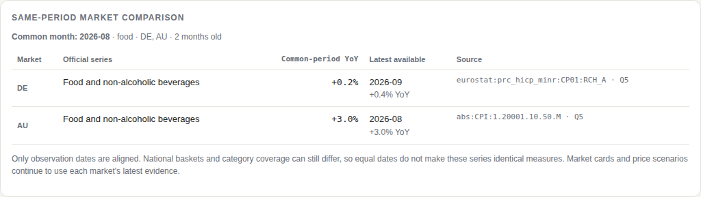

# PriceSignal

**An agent that compares an exporter's proposed price changes with official inflation and a separate cost recovery target, with the data and SQL behind each result.**

Open Agent Hackathon 2026 · Track 01 — Solving Fragmented Intelligence · built with **Zetaris**, **Meterless** (Nightshift runtime + H-MEM engine) and **NVIDIA Nemotron** (via Nightshift).


*An earlier live UI capture on 27 Oct 2026, before the local preview panel: an explicit Food inflation question takes priority over the gochujang/snacks introduction. The stated 8% cost rise, 60% unit-cost share and 70% pass-through produce a separate 3.4% cost recovery target. Market numbers appeared at 20.5 s; the full brief took 75.5 s. It reused 10 views with no planning calls, remembered Canadian/Australian product choices and selected two German product categories. The first narrative failed checks and its rewrite timed out, so the UI retained computed facts. Current CLI recordings are in [`examples/`](examples/); the current recordings include the category interpretation and sentence-boundary fixes. These measurements are not speed guarantees.*

---

## The problem

A small food exporter selling into Germany, Canada and Australia wants to check a proposed +5% price rise against market history and its own costs. The answer sits in three official statistics agencies that do not agree on anything:

| | Germany | Canada | Australia |
|---|---|---|---|
| Agency | Eurostat (HICP) | Statistics Canada (CPI) | Australian Bureau of Statistics (CPI) |
| Format | JSON-stat 2.0 | WDS JSON | SDMX-JSON 2.0 |
| What it publishes | annual rate of change | index, 2002 = 100 | index, monthly and quarterly series |
| Category scheme | ECOICOP v2 (`coicop18`) | product/vector ids | ABS index codes |
| Gotcha we hit | the dataset everyone links to (`prc_hicp_manr`) stopped at 2025-12 and was replaced by `prc_hicp_minr` | the data methods used in public recipes are POST-only; the GET method returns a top-level array | a broad query is too large for one fetch; series must be scoped to one key |

Assembling the evidence by hand means reconciling three APIs, three formats, different category schemes and different release calendars. Our latest recorded cold run used a fresh memory store and new Zetaris application tables/views: 110 s including CLI startup, with market numbers at 52.9 s. PriceSignal keeps the receipts; a repeat question reuses remembered mappings after checking their live rows and freshness. When every requested mapping is remembered, it also skips the planning model call; stale or unavailable views go back through discovery.

## What it does

1. **Understands a messy request** — typos, country nicknames (`deutschland`, `aus`), Korean or English, a proposed change (`+5%` or `-2%`), a cost recovery policy (`we pass on ~70% of cost increases`), a stated cost change and an optional cost share (`unit costs are 60% of the current selling price`). An explicit comparison such as “food inflation” takes priority over product names in the introduction. The UI shows the interpreted market category; “same as last time” keeps only assumptions the user did not change. One market category is compared per brief.
2. **Looks up official series** — by catalogue lookup at Eurostat and ABS, from a vetted vector list at Statistics Canada — and reports what it had to work around (a discontinued dataset, a coarser category, a different frequency).
3. **Onboards each series into Zetaris** as a Lightning REST table plus a decoding view with a common schema — the agency APIs become governed SQL tables.
4. **Answers with one federated SQL query** across all three agencies in Zetaris. A separate same-period table finds the latest month or quarter actually observed in every requested market, using those same query rows. This makes different release dates visible while preserving each market's latest benchmark.
5. **Joins the company's own price list.** The exporter's internal price list (SKU, market, product category, current shelf price) is a Zetaris REST table too. For narrow SKU categories, Nemotron chooses from official candidates using the actual product names (for example, honey butter chips rather than the word snacks alone). Code validates that choice before onboarding. A second federated query joins each SKU to the chosen category or an explicitly marked broader Food proxy, then code calculates hypothetical prices at those benchmark rates.
6. **Computes the facts in code** — latest year-on-year inflation, a recent one-year mean with the actual observation count, trend where a six-month comparison exists, the historical benchmark and the proposal's position against it. The model explains these facts. Numeric and comparison checks reject mismatches, request one rewrite, then use a computed summary if needed.
7. **Separates cost recovery from the market.** With "costs rose 8%, unit costs are 60% of our current selling price, pass on 70%", the price-change target is `8% × 60% × 70% = 3.36%` (displayed as 3.4%). If cost share is missing, the brief asks for it and supplies no cost-derived price target. The historical market benchmark is independent of this cost policy.
8. **Remembers** (Meterless H-MEM): series mappings, the user's pricing policy and the last request persist across sessions. "Same as last time, but +3%?" is resolved from memory, and remembered mappings skip discovery and onboarding while they still pass live freshness checks. Mappings marked for review must be rediscovered and verified before reuse. Remembered request scope includes unsupported countries; repeating a Japan-only request does not silently switch to default markets. If all requested market mappings are remembered, no planning model turn is needed. Product-checked SKU selections have separate memory scopes keyed by their product set; changing products, stale data, a review flag or a selection-version change triggers a new choice. The UI reports agent model calls (including hedged calls), planning calls, discovery calls and reused views. Internal provider retries can add HTTP attempts beyond this model-call count.

9. **Previews another proposal locally.** After a brief finishes, change the percentage in “Try another price change” to compare it with the same market benchmarks and recalculate available SKU prices from their original current prices. This separate preview sends no request, refreshes no data and writes no memory. The original narrative, proposal, cost target and saved request stay unchanged. The panel shows the run time and each observation period; unsupported or missing market evidence stays unavailable.

10. **Keeps a replayable calculation record.** The CLI writes a versioned `evidence.json` beside the brief: interpreted inputs, calculation time, actual market and pricing query columns/rows, and derived results. `npm run verify -- path/to/evidence.json` checks those calculations offline, without credentials, a memory store or live services. It reports missing coverage explicitly.

The result header distinguishes complete, partial and missing coverage of the requested market category. Unsupported countries count toward the requested total. A recovered SKU series does not imply that the market comparison also recovered. The model badge names successful model responses from the current run; provider-error text is not a model identity.

**What the market benchmark means.** It spans the latest official year-on-year rate and the mean of valid observations in the 12-month window ending at the latest observation: up to 12 monthly or four quarterly readings. The UI shows the actual coverage. Equal values produce a single reference point; negative rates remain negative. This is a descriptive comparison, not a confidence interval, a forecast, or an estimate of customers' willingness to pay. The SKU price scenario applies that same historical percentage to the current sample price; it is not a recommended price.

**What the same-period table means.** It aligns the observation date of the selected official series, with category labels, source IDs and the query reference. National baskets and category coverage can still differ. It refuses mixed monthly/quarterly sources, missing requested categories, conflicting duplicate observations or an empty period intersection instead of filling gaps. Old common periods show their age. It does not replace latest-release benchmarks, price scenarios or remembered outcomes, and needs no additional source or model call.



*Rendered from the recorded 27 Oct follow-up: both markets have August 2026 observations (DE 0.2%, AU 2.98%, displayed as 3.0%). Germany's latest September reading remains 0.4% in its market card. The live run reused eight views, made no planning or discovery calls, returned six SKUs and a narrative that passed the checks. First numbers took 30.5 s; completion took 64.0 s. An earlier three-market attempt could not align because the StatCan API reset its connections; the UI reported the missing Canadian series instead.*

**What the cost target means.** Target price change = current unit-cost share of the selling price × stated percentage change in unit costs × share of the cost change passed on. It assumes a consistent unit, currency and selling-price basis and holds sales volume and the cost mix fixed. It does not estimate a target profit margin, taxes, exchange-rate changes or demand response. Missing inputs stay missing.

The sample price list in `data/price_list.json` is illustrative data for a fictional K-food exporter. To use your own prices, set `PSIG_PRICE_LIST_URL` to an endpoint reachable from Zetaris with the same JSON schema, then start a new app process with a **fresh `PSIG_ZETARIS_NS` and memory directory**. Existing Zetaris REST tables keep their originally registered endpoint: changing the URL alone does not update them.

## Architecture

```
messy question
     │
     ▼
┌──────────────── PriceSignal agent (TypeScript) ─────────────────┐
│ planner loop: JSON action protocol, batched actions              │
│   recall_memory · use_memory_mapping · discover_and_onboard      │
│   compare · finish   (code guardrails + deterministic fallback)  │
│                                                                  │
│  LLM ──► Meterless Nightshift runtime (OpenAI-compatible /v1)    │
│          meterless/fast → pinned lane: NVIDIA Nemotron 3.5        │
│  Memory ► Meterless H-MEM engine (reference impl, conformance ✔) │
│  Data ──► Zetaris REST API  /sql-editor/sqls/run                 │
│            ├─ PSIG_EUROSTAT  (REST table → psig view)            │
│            ├─ PSIG_STATCAN   (REST table → psig view)            │
│            ├─ PSIG_ABS       (REST table → psig view)            │
│            └─ PSIG_INTERNAL  (company price list → psig view)    │
│  Guardrails: SQL allowlist, number+verdict check, staleness      │
└──────────────────────────────────────────────────────────────────┘
     │
     ▼
evidence-backed brief (per market: latest rate, trend, historical benchmark,
verdict on the proposed change, source series id, SQL behind it)
```

## Sponsor technology

**Zetaris** is where the fragmented sources become one dataset. The agent registers each agency endpoint with `CREATE LIGHTNING REST TABLE` and a decoding `CREATE SCHEMASTORE VIEW` (JSON-stat, WDS and SDMX are flattened in Lightning SQL), all in a common schema `(country, concept, category_label, frequency, period, yoy_pct, source_id)`. Market rates come from one federated `UNION ALL` query over those views, and the brief cites the statement id (Q7, Q8, …) next to each rate, with the SQL behind it listed at the end. The company's internal price list is registered the same way (`PSIG_INTERNAL`), and a second federated query joins each internal SKU with its selected official category or a marked broader Food proxy; the per-SKU rate, average and benchmark are then computed in code like the market facts. Onboarding is idempotent: when Zetaris already has a table or view from an earlier run, the trace says so ("already in Zetaris") instead of claiming it was created. Remembered and newly onboarded views must return a valid observation count and a non-future monthly/quarterly period within the freshness window (three months for monthly series, six for quarterly). ABS and StatCan index views calculate YoY only against the same month or quarter one year earlier with a positive denominator. Versioned decoding views keep monthly and quarterly definitions separate; obsolete mappings are rediscovered and replaced only after the new view passes validation. Source IDs stay unchanged, and the brief distinguishes a decoder change from an official data revision. A small successor map handles known dataset moves, such as Eurostat's `prc_hicp_manr` → `prc_hicp_minr`. Every SQL statement the agent sends passes an allowlist (`SELECT`, plus the `CREATE LIGHTNING …` / `CREATE SCHEMASTORE …` statements used for onboarding); anything else is blocked in code.

**Meterless Nightshift** is the application's primary AI provider. The app implements the Meterless Runtime provider contract: OpenAI-compatible `/v1/chat/completions`, Bearer runtime token, `meterless-app` on every request, `meterless-scope: user` on chat, `GET /v1/models` to decide online / unauthorized / offline, and the `meterless/fast` routing mode (`meterless/deep` is configurable but not used by default). The model that served each step is shown in the agent trace. Nemotron's response time through Nightshift varied from about 1 s to over 50 s between consecutive calls on 26 Oct, so parsing, planning and narrative calls are hedged: if no reply has come after 10 s (`PSIG_HEDGE_MS`), the same request is sent once more, the first reply wins and the other request is cancelled; the trace says when this happened.

**Meterless H-MEM** gives the agent memory across sessions. We run the Meterless reference engine unchanged (`src/hmem_impl.ts` re-exports it, and `npm run conformance` runs the official suite against that file: 13/13). Our work is in how the agent uses it: series mappings are long-term factual memories with structured tags, so a recalled memory changes what the agent does next (skip discovery and onboarding); a re-onboarded series supersedes the old mapping; reused mappings get `helpful` feedback; the pricing policy is a preference memory and the brief says when it was remembered rather than stated; and the last request is stored so "same as last time" works.

**NVIDIA Nemotron** powers the agent. Nightshift has a pinned lane ("Use tools & agents") serving NVIDIA Nemotron 3.5 Lightning, so every `meterless/fast` call (request parsing, planning, SKU category selection, narrative) is routed through the Nemotron-pinned Nightshift lane. In the six recorded questions on 27 Oct 2026, successful model replies recorded in the traces identify `nvidia/nemotron-3.5-lightning`. Product selection succeeded for six product groups in example 01; subsequent examples reused those validated choices. Narrative generation succeeded in three of the six runs. For narrow SKU categories, one bounded request sees product names and official candidate labels, and selects an index with a coverage reason. It cannot invent a source or query. Code rejects invalid choices, known savoury-chip/confectionery conflicts and reasons containing numeric claims or common price-advice patterns. The choice has a 20-second limit and no hedge; failure uses a verified broad Food series, visibly labelled "Unconfirmed match", or omits those SKU prices when no such alternative is usable. Validated model selections are remembered separately from general market mappings.

## Markets

Germany, Canada and Australia are the demo markets. Because Eurostat publishes HICP for every EU member through the same API, the same discover-and-onboard path also covers France, Italy, Spain, the Netherlands, Belgium, Austria, Ireland, Portugal, Finland, Sweden, Denmark, Poland and Czechia (market names, local names or ISO codes). Markets outside these are reported as not covered rather than silently dropped. The EU path was verified live on 27 Oct 2026 for France, Italy and Spain (six views registered, one federated query of 90 rows; see `examples/06_eu_markets`). The sample price list only has SKUs for Germany, Canada and Australia.

## Limits (stated, not hidden)

- **Canada:** our adapter maps only StatCan's Food and All-items CPI vectors, so narrower categories (snacks, sauces) are compared at the Food level and the brief says so.
- **SKU categories** use product-aware model selection from a bounded official shortlist. A broader series can still be the best available proxy; the table distinguishes model-selected, remembered and unconfirmed matches and names the actual series. This is a coverage check, not a guarantee that an official category precisely describes each product. Market-category lookup is a separate catalogue-matching path. A guard rejects known sweet-only categories for a snacks comparison and uses a verified broader Food alternative or omits the category. This targeted guard does not validate every possible product match. The current recordings include this guard and the explicit comparison-category override; check each actual series label.
- **Historical benchmarks are descriptive.** A point or narrow span is possible; it does not express confidence, price headroom or a prediction. Cost recovery requires both a stated cost change and the current cost-to-price share.
- **SQL result completeness:** the client refuses results reaching the requested row limit (1,000 by default), because a complete result cannot be confirmed. SKU prices are omitted when their query is incomplete; even a result of exactly 1,000 complete rows is conservatively refused. There is no automatic pagination.
- **The price list is sample data** for a fictional exporter.
- **Speed** depends on the provider and source queries: the current six CLI recordings took 21–110 s per question, with market numbers at 9.1–52.9 s. Market numbers are shown immediately after the federated comparison, before SKU discovery and pricing finish; SKU prices and the checked prose follow. A disconnected UI retries the event stream for up to 10 s, preserving available numbers and replaying the latest snapshot on reconnection.

## Recorded runs in `examples/` (27 Oct 2026 KST, Nemotron via Nightshift)

The six questions were run consecutively by `scripts/15_examples.sh` with a new H-MEM store and fresh Zetaris suffix. Each folder contains the actual brief, full trace, recording metadata and versioned SQL-row evidence packet. These runs use the current historical-benchmark method and require a cost-to-price share for the cost target.

| Example | What happened | CLI elapsed / first numbers |
|---|---|---|
| `01_cold_start` | Messy DE/CA/AU Food request with separate sentences: costs +8%, cost share 60%, policy 70%, proposal +5% → cost target 3.4%. Created 10 REST tables and 13 views; Nemotron selected six product groups in 19.7 s; 9 SKU scenarios. Provider error and timeout omitted the narrative. | 110 s / 52.9 s |
| `02_same_as_last_time` | Proposal −2%; cost assumptions and markets remembered, 12 views reused, no planning, discovery or new DDL. All product selections were reused. Narrative timed out. | 94 s / 39.5 s |
| `03_typo_market` | “canda” → Canada. Policy changes to 60%; +4% is within the broader Food benchmark used for snacks. Product choices reused; narrative checks passed. | 66 s / 44.8 s |
| `04_unsupported_market` | Japan explicitly not covered; Canada +5% is above its Food benchmark. Canadian product mappings reused; narrative checks passed. | 21 s / 9.1 s |
| `05_within_range` | CA/AU Food, +3% within both benchmarks; separate cost target 3.4%. Eight views reused, no planning or discovery. Narrative rejected, rewrite timed out. | 68 s / 13.0 s |
| `06_eu_markets` | FR/IT/ES: six new Eurostat series, 90 comparison rows, +3% above all benchmarks. No matching sample SKUs. Narrative checks passed. | 83 s / 44.2 s |

These are measured runs, not speed or completion guarantees. They include the versioned calendar-based ABS/StatCan YoY decoder, explicit comparison-category override, common-period comparison and sentence-boundary correction. The first request resolves to Food even though its product introduction mentions snacks. Examples 01 and 02 had provider failures or timeouts before a validated narrative; example 05 rejected mixed Canadian/Australian values before its rewrite timed out. Calculated facts remained available in each case. All six evidence packets passed offline replay, preserving 368 market rows and 417 pricing rows; the verifier reports the unsupported Japanese request separately. The older policy-scaled and category-mismatched recordings remain in Git history and local recording backups. [Recording notes](examples/README.md) distinguish validated selection, reuse, broader proxies and narrative failure.

## Run it

Requirements: Node 20+, npm, Docker with a running Zetaris instance and REST API credentials, and Meterless Nightshift reachable from the app with a runtime token and a configured model provider. Obtaining the Zetaris image requires the hackathon registry login. For the demonstrated NVIDIA route, configure a Nightshift lane to pin NVIDIA Nemotron 3.5 Lightning; the app's `meterless/fast` alias alone does not select that model. The shell helpers and their offline regression tests require Bash; the example recorder also uses `timeout` (GNU coreutils). Generated-SQL regression tests require Python 3 with its standard-library `sqlite3` module.

```bash
npm install
npm run setup               # vendors the Meterless H-MEM reference engine into vendor/hmem
npm run setup:conformance   # vendors the H-MEM conformance suite
npm run conformance         # 13/13 checks pass against src/hmem_impl.ts
npm test                    # offline agent tests (fake model, fake Zetaris)
npm run typecheck           # strict TypeScript check of src/ and tests/ (after npm run setup)
# Verify a recorded calculation without starting Zetaris or Nightshift:
npm run verify -- examples/01_cold_start/evidence.json

cp .env.example .env        # then fill in (never commit .env):
#   ZETARIS_REST_URL, ZETARIS_ORG_ID, ZETARIS_API_KEY
#   LLM_PROVIDER=meterless, METERLESS_BASE_URL (Nightshift Console), METERLESS_RUNTIME_TOKEN

npm run smoke               # Zetaris, Nightshift, the three agencies, H-MEM
npm run ui                  # http://localhost:5177
# a new suffix on EVERY cold recording; keep the same UI process for the memory repeat
PSIG_RUN_ID=$(date -u +%Y%m%dT%H%M%S)-$$
PSIG_MEMORY_DIR=".pricesignal/cold-$PSIG_RUN_ID" PSIG_ZETARIS_NS="$PSIG_RUN_ID" npm run ui
npm run ask -- "is food inflation in deutschland, canada & aus still hot? thinking +5%"
```

`npm run setup` and `setup:conformance` download the upstream H-MEM reference code and conformance suite; they need network access and are not pinned dependency snapshots. `npm test` and `npm run typecheck` run locally after setup. Do not run multiple app processes against the same memory directory.

Helper scripts used on our machine (Ubuntu laptop + Windows desktop running Nightshift) are in `scripts/` (Docker install, Zetaris install, secret entry without echo, smoke tests, integration probe, network check). `scripts/03_app_setup.sh` stops at the first failed step and returns its exit code. `bash scripts/15_examples.sh` creates a fresh experimental store and Zetaris suffix by default. It replaces the six example folders only after every run exits successfully and saves a brief, a valid trace and its evidence packet. Prior recordings and logs remain under `logs/`; a supplied memory directory must not already exist.

## Verify a saved calculation

Each new CLI run writes `out/<run>/evidence.json` alongside `brief.md` and `trace.json`. The schema and calculation method are versioned. The packet preserves query IDs, SQL, returned column metadata, unrounded rows, interpreted request, cost policy, calculation time and computed results. The CLI checks the packet before reporting a saved run; an unsupported format or inconsistent calculation fails verification.

```bash
npm run verify -- out/<run>/evidence.json
npm run --silent verify -- out/<run>/evidence.json --json
```

Verification replays market means and observation counts, benchmarks, proposal and cost comparisons, common-period alignment and available SKU price arithmetic. Missing market evidence or omitted SKU pricing is reported, not filled in. The same saved calculation time is used even if verification runs months later. This checks consistency between the saved rows and results: it does not authenticate an agency response, recompute index-to-YoY decoding from upstream raw indices, assess product-category suitability, or validate all meanings in model prose. Changing both inputs and results consistently can still pass. Keep the original packet when comparing changes. The UI does not currently export these CLI packets.

## Repository layout

```
src/agent.ts          planner loop, actions, guardrails
src/selection.ts      bounded product-aware official-series selection and validation
src/brief.ts          facts computed from Zetaris rows, number and verdict check, rendering
src/sources/          one adapter per agency: discover() + Lightning SQL onboarding templates;
                      pricelist.ts registers the internal price list and joins it with the rates
data/price_list.json  sample internal price list (fictional exporter)
examples/             real runs: brief.md, trace.json, recording.json and evidence.json
src/evidence.ts       versioned SQL-row snapshots and offline calculation verification
src/verify.ts         local evidence verification command
src/zetaris.ts        Zetaris REST client
src/llm.ts            Meterless Runtime provider (plus dev fallbacks)
src/memory.ts         agent memory on H-MEM
src/hmem_impl.ts      the H-MEM implementation the agent runs and the conformance suite tests
src/server.ts         UI server (Server-Sent Events trace)
public/index.html     single-page UI
public/scenario.js    pure local proposal comparisons and SKU price calculations
public/preview-panel.js separate preview panel; no network or memory writes
tests/                offline tests
```

## What was built during the window

Everything in this repository was written during the build window (22–27 October 2026). Pre-existing open-source components, used unchanged: the Meterless H-MEM reference implementation and conformance suite (Apache-2.0, vendored by `npm run setup`), and the Lightning SQL decoding patterns documented in Zetaris's getting-started recipes. No other pre-existing product code is included.

## Data sources and licences

Eurostat (`prc_hicp_minr`, re-use policy aligned with CC BY 4.0), Statistics Canada table 18-10-0004-01 (Statistics Canada Open Licence), Australian Bureau of Statistics CPI (CC BY). PriceSignal reports official statistics and explicit scenarios; it does not estimate demand or guarantee a pricing outcome.
