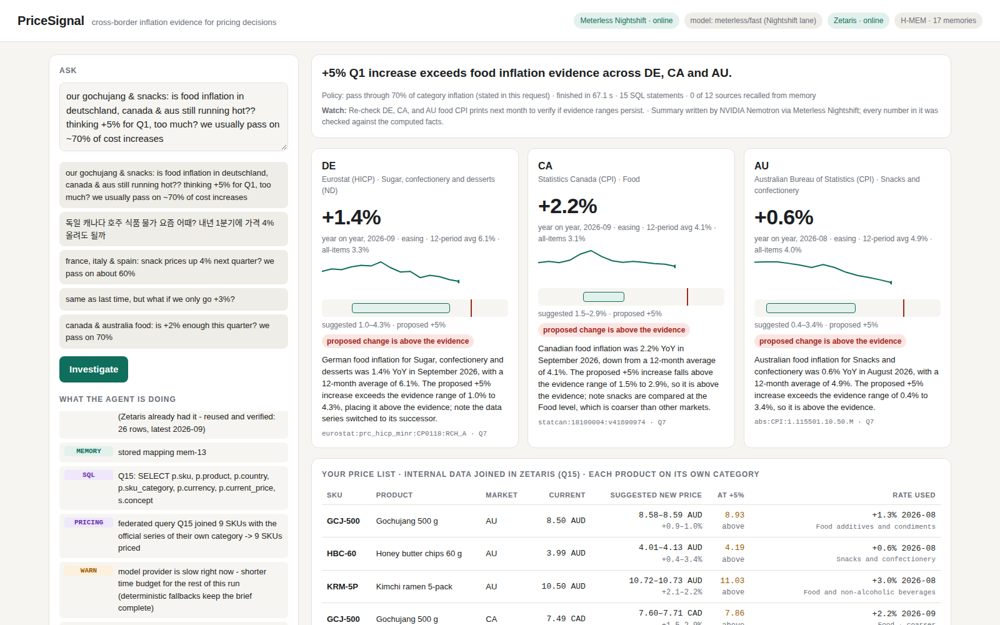

# PriceSignal

**An agent that tells an exporter's pricing manager how much to raise prices in each market, and shows the official evidence behind every number.**

Open Agent Hackathon 2026 · Track 01 — Solving Fragmented Intelligence · built with **Zetaris**, **Meterless** (Nightshift runtime + H-MEM engine) and **NVIDIA Nemotron** (via Nightshift).



*A live run on 26 Oct 2026 with an empty memory: every model call in the trace was answered by NVIDIA Nemotron 3.5 Lightning through Meterless Nightshift. The numbers were on screen at 37 s and the brief, with Nemotron's paragraph per market, at 67 s. Real outputs with full traces are in [`examples/`](examples/).*

---

## The problem

A small food exporter selling into Germany, Canada and Australia wants to know whether a +5% price rise next quarter is justified. The answer sits in three official statistics agencies that do not agree on anything:

| | Germany | Canada | Australia |
|---|---|---|---|
| Agency | Eurostat (HICP) | Statistics Canada (CPI) | Australian Bureau of Statistics (CPI) |
| Format | JSON-stat 2.0 | WDS JSON | SDMX-JSON 2.0 |
| What it publishes | annual rate of change | index, 2002 = 100 | index, monthly and quarterly series |
| Category scheme | ECOICOP v2 (`coicop18`) | product/vector ids | ABS index codes |
| Gotcha we hit | the dataset everyone links to (`prc_hicp_manr`) stopped at 2025-12 and was replaced by `prc_hicp_minr` | the data methods used in public recipes are POST-only; the GET method returns a top-level array | a broad query is too large for one fetch; series must be scoped to one key |

Assembling a comparable answer by hand means three APIs, three formats and three category schemes every pricing round, so small exporters often just pick a round number. PriceSignal answered a cold start (nothing in memory, nothing registered in Zetaris) in 48 s in our recorded run, and keeps the receipts; a repeat question skips discovery and onboarding entirely.

## What it does

1. **Understands a messy request** — typos, country nicknames (`deutschland`, `aus`), category slang (`gochujang & snacks`), Korean or English, a proposed change (`+5%`) and a pricing policy (`we pass on ~70% of cost increases`).
2. **Finds the matching official series** — by catalogue lookup at Eurostat and ABS, from a vetted vector list at Statistics Canada — and reports what it had to work around (a discontinued dataset, a coarser category, a different frequency).
3. **Onboards each series into Zetaris** as a Lightning REST table plus a decoding view with a common schema — the agency APIs become governed SQL tables.
4. **Answers with one federated SQL query** across all three agencies in Zetaris.
5. **Joins the company's own price list.** The exporter's internal price list (SKU, market, product category, current shelf price) is a Zetaris REST table too. A second federated query joins each SKU with the official series of its own category in its market (gochujang → condiments, chips → snacks, ramen → food; missing category series are onboarded first), so the brief ends with a suggested new price per SKU.
6. **Computes the facts in code** (latest year-on-year rate, 12-period average, trend, staleness, suggested range, verdict, new SKU prices) and lets the model write only the prose. Numbers in the prose must match a computed fact, the request or the policy; otherwise the model rewrites once and then a deterministic summary is used.
7. **Remembers** (Meterless H-MEM): series mappings, the user's pricing policy and the last request persist across sessions. "Same as last time, but +3%?" is resolved from memory, and remembered mappings skip discovery and onboarding.

**What the suggested range means.** Range = your pass-through share × how much consumer prices for that category have moved in that market over the latest month and the 12-month average. It is a market-side check ("how much room do shelf prices in this category give us?"), not a measure of your own costs.

The sample price list in `data/price_list.json` is illustrative data for a fictional K-food exporter; point `PSIG_PRICE_LIST_URL` at your own endpoint to use real prices.

## Architecture

```
messy question
     │
     ▼
┌──────────────── PriceSignal agent (TypeScript) ─────────────────┐
│ planner loop: JSON action protocol, batched actions              │
│   recall_memory · use_memory_mapping · discover_and_onboard      │
│   compare · finish   (code guardrails + deterministic fallback)  │
│                                                                  │
│  LLM ──► Meterless Nightshift runtime (OpenAI-compatible /v1)    │
│          meterless/fast → pinned lane: NVIDIA Nemotron 3.5        │
│  Memory ► Meterless H-MEM engine (reference impl, conformance ✔) │
│  Data ──► Zetaris REST API  /sql-editor/sqls/run                 │
│            ├─ PSIG_EUROSTAT  (REST table → psig view)            │
│            ├─ PSIG_STATCAN   (REST table → psig view)            │
│            ├─ PSIG_ABS       (REST table → psig view)            │
│            └─ PSIG_INTERNAL  (company price list → psig view)    │
│  Guardrails: SQL allowlist, number-grounding check, staleness    │
└──────────────────────────────────────────────────────────────────┘
     │
     ▼
evidence-backed brief (per market: latest rate, trend, suggested range,
verdict on the proposed change, source series id, SQL behind it)
```

## Sponsor technology

**Zetaris** is where the fragmented sources become one dataset. The agent registers each agency endpoint with `CREATE LIGHTNING REST TABLE` and a decoding `CREATE SCHEMASTORE VIEW` (JSON-stat, WDS and SDMX are flattened in Lightning SQL), all in a common schema `(country, concept, category_label, frequency, period, yoy_pct, source_id)`. Every official rate the user sees comes from one federated `UNION ALL` query over those views, and the brief cites the statement id (Q7, Q8, …) next to each rate, with the SQL behind it listed at the end. The company's internal price list is registered the same way (`PSIG_INTERNAL`), and a second federated query joins each internal SKU with the official series of its own category in its market; the per-SKU rate, average and range are then computed in code like the market facts. Onboarding is idempotent: when Zetaris already has a table or view from an earlier run, the trace says so ("already in Zetaris") instead of claiming it was created. Remembered views are checked before reuse: a view whose data stops more than three months ago (six for quarterly series) is not reused, and the agent goes back to discovery. A small successor map handles known dataset moves, such as Eurostat's `prc_hicp_manr` → `prc_hicp_minr`. Every SQL statement the agent sends passes an allowlist (`SELECT`, plus the `CREATE LIGHTNING …` / `CREATE SCHEMASTORE …` statements used for onboarding); anything else is blocked in code.

**Meterless Nightshift** is the application's primary AI provider. The app implements the Meterless Runtime provider contract: OpenAI-compatible `/v1/chat/completions`, Bearer runtime token, `meterless-app` on every request, `meterless-scope: user` on chat, `GET /v1/models` to decide online / unauthorized / offline, and the `meterless/fast` routing mode (`meterless/deep` is configurable but not used by default). The model that served each step is shown in the agent trace.

**Meterless H-MEM** gives the agent memory across sessions. We run the Meterless reference engine unchanged (`src/hmem_impl.ts` re-exports it, and `npm run conformance` runs the official suite against that file: 13/13). Our work is in how the agent uses it: series mappings are long-term factual memories with structured tags, so a recalled memory changes what the agent does next (skip discovery and onboarding); a re-onboarded series supersedes the old mapping; reused mappings get `helpful` feedback; the pricing policy is a preference memory and the brief says when it was remembered rather than stated; and the last request is stored so "same as last time" works.

**NVIDIA Nemotron** powers the agent. Nightshift has a pinned lane ("Use tools & agents") serving NVIDIA Nemotron 3.5 Lightning, so every `meterless/fast` call (request parsing, planning, narrative) is answered by Nemotron. In our robustness run on 26 Oct 2026, every model call in all six questions was served by `nvidia/nemotron-3.5-lightning`, as shown in the trace logs.

## Markets

Germany, Canada and Australia are the demo markets. Because Eurostat publishes HICP for every EU member through the same API, the same discover-and-onboard path also covers France, Italy, Spain, the Netherlands, Belgium, Austria, Ireland, Portugal, Finland, Sweden, Denmark, Poland and Czechia (market names, local names or ISO codes). Markets outside these are reported as not covered rather than silently dropped. The EU path was verified live on 26 Oct 2026 for France, Italy and Spain (six views registered, one federated query of 90 rows; see `examples/06_eu_markets`). The sample price list only has SKUs for Germany, Canada and Australia.

## Limits (stated, not hidden)

- **Canada:** our adapter maps only StatCan's Food and All-items CPI vectors, so narrower categories (snacks, sauces) are compared at the Food level and the brief says so.
- **SKU categories** are matched to the nearest published series by label, so honey butter chips in Germany are priced on Eurostat's "Sugar, confectionery and desserts" and in Canada on Food; the SKU table names the series used for each product.
- **The range is a market-side check** on consumer prices, not a cost model; it is often narrow, so most proposals land above or below it.
- **The price list is sample data** for a fictional exporter.
- **Speed** depends on the model's response time, which varied from 1 s to 43 s per call in our runs: 36–113 s per question in `examples/`. The numbers are shown as soon as they are computed; the prose follows.

## Robustness: live runs in `examples/` (26 Oct 2026, Nemotron via Nightshift)

The six questions below were run back to back by `scripts/15_examples.sh` with an empty H-MEM store and a fresh set of Zetaris object names (`PSIG_ZETARIS_NS`), so the first run really discovers and registers everything; each later run uses what the earlier ones left in memory. Every brief and its full trace is in the folder named.

| Example | Question | What happened | Time |
|---|---|---|---|
| `01_cold_start` | "our gochujang & snacks: is food inflation in deutschland, canada & aus still running hot?? thinking +5% … we usually pass on ~70%" | 12 series found at three agencies and registered in Zetaris (11 REST tables, 13 views incl. the price list); 9 SKUs priced on their own category; +5% above the evidence in DE, CA and AU | 48 s (numbers at 27 s) |
| `02_same_as_last_time` | "same as last time, but what if we only go +3%?" | markets, category and the 70% policy recalled from H-MEM; 12 views reused, nothing registered again; +3% within the evidence in DE and AU, above in CA; "Since your last brief" compares each market with run 01 | 113 s; Nemotron's summary failed (empty response, then timeout), so the computed summary was shown |
| `03_typo_market` | "canda snacks price hike 4%?? is that ok, we pass thru like 60pct of costs" | "canda" resolved to Canada only; the 60% policy supersedes the remembered 70%; snacks compared at the Food level, and the brief says so | 36 s |
| `04_unsupported_market` | "japan + canada food prices, ok to raise 5%?" | Canada answered; "japan: not covered yet" stated in the brief | 48 s |
| `05_within_range` | "canada & australia food: is +2% enough this quarter? we pass on 70%" | within the evidence in CA, below it in AU | 51 s |
| `06_eu_markets` | "france, italy and spain food prices: can we go +3%? we pass on about 70%" | six more Eurostat series registered and compared in one federated query (90 rows) | 113 s |

Run time is mostly the model: a single Nemotron call through Nightshift took between 1 s and 43 s in these runs. An earlier robustness run of six other messy questions (Korean, all-caps, "oz" for Australia) surfaced four bugs (typo dropped a market, an unsupported market silently ignored, a remembered series not reused before comparison, a verdict with a hidden tolerance contradicting the prose); all four are fixed, and the runs above go through the same cases (a typo, an unsupported market, memory reuse, verdicts other than "above").

## Run it

Requirements: Node 20+, Docker (for Zetaris), a Zetaris hackathon registry login, and Meterless Nightshift running on a Windows/Mac machine reachable from the app.

```bash
npm install
npm run setup               # vendors the Meterless H-MEM reference engine into vendor/hmem
npm run setup:conformance   # vendors the H-MEM conformance suite
npm run conformance         # 13/13 checks pass against src/hmem_impl.ts
npm test                    # offline agent tests (fake model, fake Zetaris)

cp .env.example .env        # then fill in (never commit .env):
#   ZETARIS_REST_URL, ZETARIS_ORG_ID, ZETARIS_API_KEY
#   LLM_PROVIDER=meterless, METERLESS_BASE_URL (Nightshift Console), METERLESS_RUNTIME_TOKEN

npm run smoke               # Zetaris, Nightshift, the three agencies, H-MEM
npm run ui                  # http://localhost:5177
# a true cold start: fresh H-MEM store and a fresh set of Zetaris tables/views (names get the suffix)
PSIG_MEMORY_DIR=.pricesignal/cold PSIG_ZETARIS_NS=cold1 npm run ui
npm run ask -- "is food inflation in deutschland, canada & aus still hot? thinking +5%"
```

Helper scripts used on our machine (Ubuntu laptop + Windows desktop running Nightshift) are in `scripts/` (Docker install, Zetaris install, secret entry without echo, smoke tests, integration probe, network check).

## Repository layout

```
src/agent.ts          planner loop, actions, guardrails
src/brief.ts          facts computed from Zetaris rows, number-grounding check, rendering
src/sources/          one adapter per agency: discover() + Lightning SQL onboarding templates;
                      pricelist.ts registers the internal price list and joins it with the rates
data/price_list.json  sample internal price list (fictional exporter)
examples/             real runs: brief.md plus trace.json with every model call and SQL statement
src/zetaris.ts        Zetaris REST client
src/llm.ts            Meterless Runtime provider (plus dev fallbacks)
src/memory.ts         agent memory on H-MEM
src/hmem_impl.ts      the H-MEM implementation the agent runs and the conformance suite tests
src/server.ts         UI server (Server-Sent Events trace)
public/index.html     single-page UI
tests/                offline tests
```

## What was built during the window

Everything in this repository was written during the build window (22–27 October 2026). Pre-existing open-source components, used unchanged: the Meterless H-MEM reference implementation and conformance suite (Apache-2.0, vendored by `npm run setup`), and the Lightning SQL decoding patterns documented in Zetaris's getting-started recipes. No other pre-existing product code is included.

## Data sources and licences

Eurostat (`prc_hicp_minr`, re-use policy aligned with CC BY 4.0), Statistics Canada table 18-10-0004-01 (Statistics Canada Open Licence), Australian Bureau of Statistics CPI (CC BY). PriceSignal reports official statistics; its suggested ranges are a decision aid, not financial advice.
